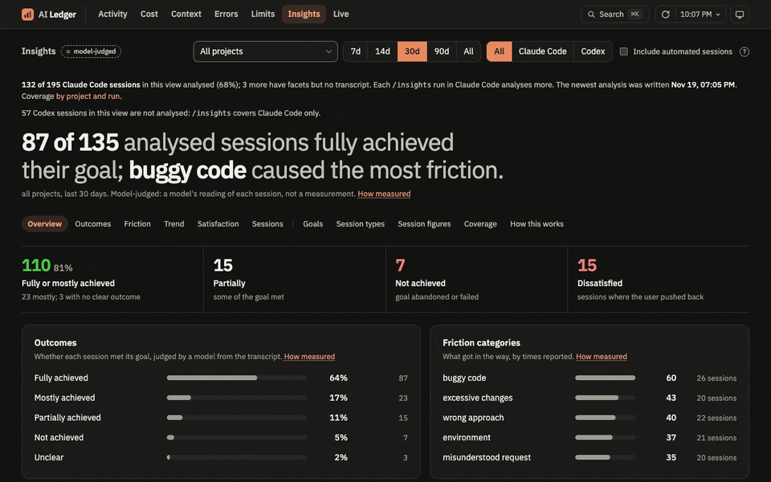

# AI Ledger

**See what your coding agents did, what it cost, and where they got stuck.**

AI Ledger reads your Claude Code and Codex transcripts and turns them into seven local dashboards. Your agents delete old transcripts; AI Ledger keeps every line.

<picture><source media="(prefers-color-scheme: light)" srcset="https://raw.githubusercontent.com/nWidart/ai-ledger/main/docs/tour-light.gif"></picture>

## Quick start

```bash
uvx ai-ledger    # opens http://127.0.0.1:8765/ in your browser
```

Needs [uv](https://docs.astral.sh/uv/). Runs on macOS and Linux. Your data stays on your machine (see [Privacy](#privacy)).

## What you get

| Page | Shows |
| --- | --- |
| **Activity** | What got done per day or week, by project, and what needs your attention. |
| **Cost** | Estimated spend at API list prices, per project, model and session, compared with your plan. |
| **Context** | How full the context window gets, how fast it grows, and what fills it. |
| **Errors** | Failed tool calls by type, the time they cost, and a fix to paste into `CLAUDE.md` or `AGENTS.md`. |
| **Limits** | Each plan limit window, what used it, and a forecast to its reset. |
| **Insights** | How Claude Code's `/insights` judged your sessions. |
| **Live** | Every active session as it runs, sorted by who needs you first. |
| **Project** | One project across all of the above, opened from the Page button on the navigation's project filter, its sheet, or its name in the command palette. |

Press **Cmd+K** to jump anywhere, for example `>errors #myproject #7d`. Every page works by keyboard and screen reader, and each chart has a data table.

The [user guide](https://github.com/nWidart/ai-ledger/blob/main/docs/guide.md) describes each page in detail.

<table>
<tr><td><picture><source media="(prefers-color-scheme: light)" srcset="https://raw.githubusercontent.com/nWidart/ai-ledger/main/docs/activity-light.gif"></picture></td><td><picture><source media="(prefers-color-scheme: light)" srcset="https://raw.githubusercontent.com/nWidart/ai-ledger/main/docs/cost-light.gif"></picture></td></tr>
<tr><td><picture><source media="(prefers-color-scheme: light)" srcset="https://raw.githubusercontent.com/nWidart/ai-ledger/main/docs/errors-light.gif"></picture></td><td><picture><source media="(prefers-color-scheme: light)" srcset="https://raw.githubusercontent.com/nWidart/ai-ledger/main/docs/limits-light.gif"></picture></td></tr>
<tr><td><picture><source media="(prefers-color-scheme: light)" srcset="https://raw.githubusercontent.com/nWidart/ai-ledger/main/docs/insights-light.gif"></picture></td><td><picture><source media="(prefers-color-scheme: light)" srcset="https://raw.githubusercontent.com/nWidart/ai-ledger/main/docs/live-light.gif"></picture></td></tr>
</table>

## Install

```bash
uv tool install ai-ledger
ai-ledger                   # serve on http://127.0.0.1:8765/ and open it
uv tool upgrade ai-ledger   # new version and new prices
```

The first start reads every transcript, about 4 minutes for 3.4 GB. After that, the app picks up new lines every 60 seconds.

| Option | Default |
| --- | --- |
| `--port` | `8765` |
| `--no-open` | off (opens the browser) |
| `--projects` | `~/.claude/projects` |
| `--codex` | `~/.codex` |
| `--usage-data` | `~/.claude/usage-data` |
| `--db` | `~/Library/Application Support/ai-ledger/ai-ledger.duckdb` (macOS), `~/.local/share/ai-ledger/ai-ledger.duckdb` (Linux) |

With the app stopped, `ai-ledger ingest` reads new lines once and `ai-ledger rebuild` recomputes the derived tables. After an upgrade that asks for it, run `ai-ledger rebuild` once.

To set your own model prices or plan prices, or to hide more automated projects, see [Configuration](https://github.com/nWidart/ai-ledger/blob/main/docs/guide.md#configuration).

## Privacy

- The server listens on `127.0.0.1` only, and refuses requests that another site makes from your browser.
- The store keeps every transcript line, **including any secrets** that appeared in a session. Only your user can read it. Do not share it.
- On macOS, the Limits page sends your Claude Code OAuth token from the Keychain to Anthropic's usage endpoint every 5 minutes. The token goes nowhere else and is never stored or logged. On Linux, Limits estimates from transcripts.
- Live's **Full text** puts transcript content on screen, secrets included. Turn it off before you share your screen.
- Your browser loads the font from Google Fonts. No transcript data goes with it.

## Contributing

See [CONTRIBUTING.md](https://github.com/nWidart/ai-ledger/blob/main/CONTRIBUTING.md).

## License

[MIT](https://github.com/nWidart/ai-ledger/blob/main/LICENSE)
