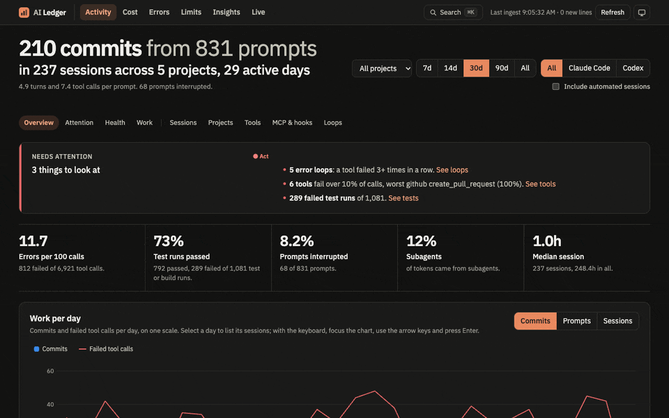
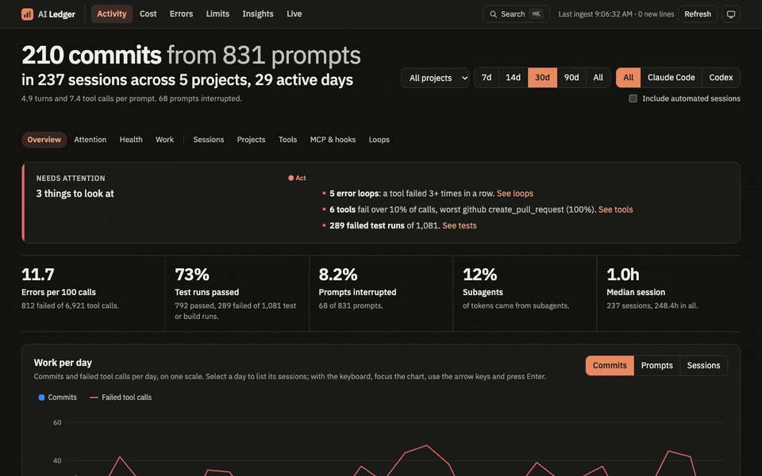
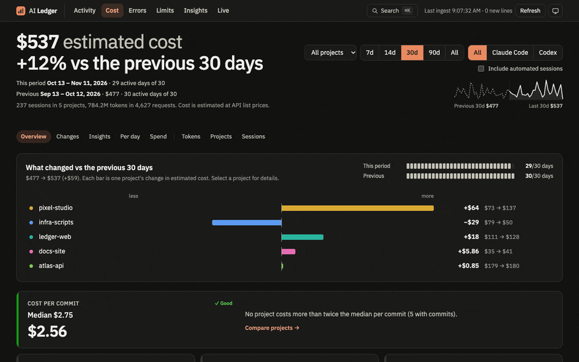
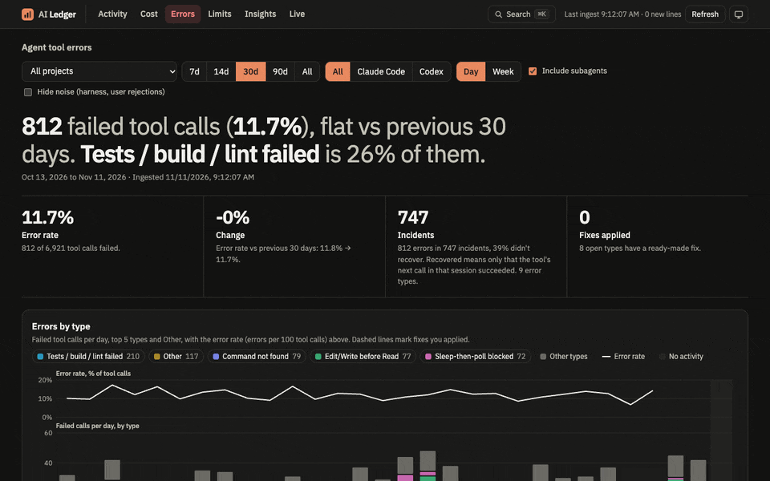
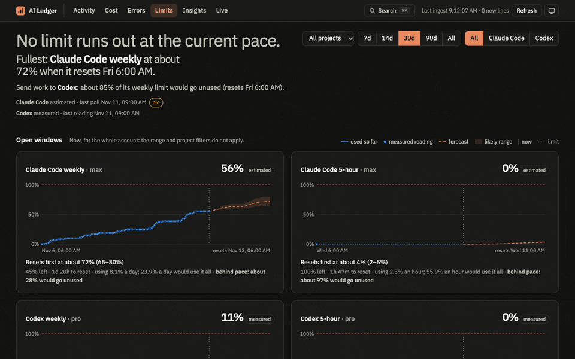
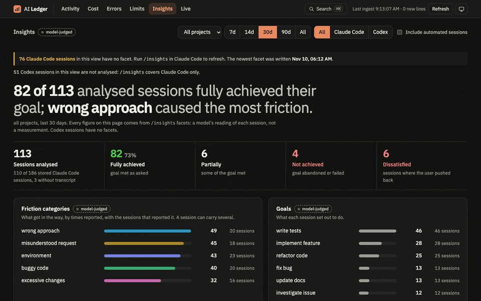
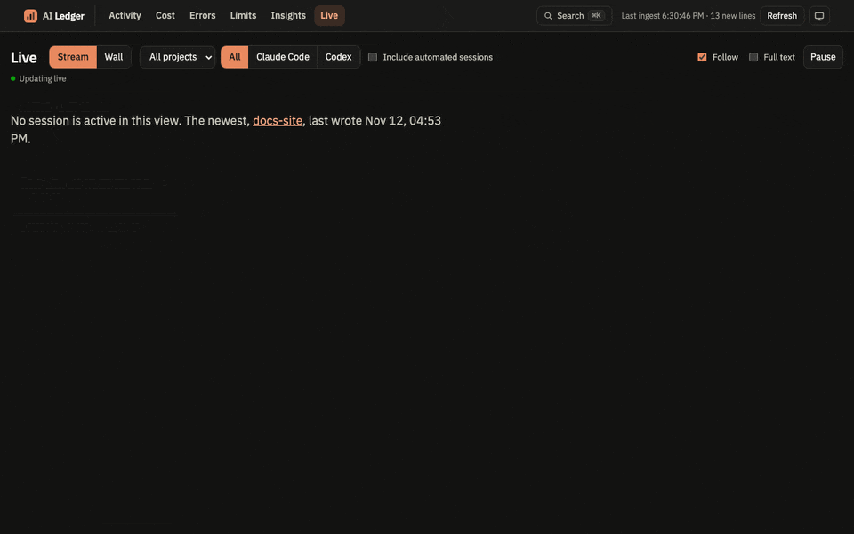

# AI Ledger

See what your coding agents did, what it cost, and where they got stuck. AI Ledger turns your Claude Code and Codex transcripts into six local dashboards.

<picture><source media="(prefers-color-scheme: light)" srcset="https://raw.githubusercontent.com/nWidart/ai-ledger/main/docs/tour-light.gif"></picture>

```bash
uvx ai-ledger    # opens http://127.0.0.1:8765/ in your browser
```

Needs [uv](https://docs.astral.sh/uv/). macOS and Linux. Nothing leaves your machine except the Limits check under [Privacy](https://github.com/nWidart/ai-ledger#privacy).

## What you get

- **Activity**: what got done per day or week, stacked by project, with errors per 100 calls on the chart, prompts by hour and weekday, and the change against the period before. It lists what needs attention, down to the failed test runs. Tables sort by column, a day on the chart narrows Tools, MCP & hooks and Error loops to it, and the Sessions filters live in the URL.
- **Cost**: estimated spend at API list prices, per project, model and session, against the period before, with the daily chart stackable by project, model or agent, today's bar hatched as a partial day, and the month's run rate. Its project and session tables download as CSV or copy to the clipboard. Cost by project folds scratch projects into one "Small projects" row, and the project picker gets a search box once it lists more than 12 projects.
- **Errors**: failed tool calls by type, with the time each type lost in retry loops and a fix to paste into `CLAUDE.md` or `AGENTS.md`. Where to start ranks the open fixes by that time lost. The summary shows the share of errors in the catch-all types (Other, Other non-zero exit, MCP tool error), split by agent when both agents have errors, so a growing catch-all is visible. A click on a day or week of the chart narrows the type table and the examples to it. A link to an example the store no longer holds says so. Mark a type "fix applied" on a day to see its error rate before and after; the markers live in the store, so they follow you across ports and browsers.
- **Limits**: each plan limit window, with a forecast to its reset.
- **Insights**: how Claude Code's `/insights` judged your sessions.
- **Live**: every active session as it runs: prompts, tool calls, subagents, context and cost.

Your agents delete old transcripts. AI Ledger keeps every line, so the history stays. Press **Cmd+K** to jump anywhere: `>errors #myproject #7d`.

The pages leave out sessions a tool started: claude-mem's `observer-sessions`, sessions with no prompt, and the one-prompt helpers apps run in temporary folders (session titles and the like). **Include automated** shows them. An active day is a day with a prompt.

To leave out more projects, create `automated.json` next to the store, in the same folder as `prices.json` below: `{"projects": ["my-bot"]}`. Its names add to the built-in detection. The app reads it on every page load, so no restart is needed. If the file cannot be used, the app ignores it and Activity says why.

Live lists the sessions that wrote in the last 10 minutes, grouped by who needs you first: **approval?** (a shell call pending for more than 30 seconds, likely waiting for your approval), **your turn**, **working**, **idle**, **ended**. A session keeps its place in its group until its state changes. A session on your turn shows how long it has waited, and the tab title counts the sessions that need you: `(2) Live · AI Ledger`. A Claude Code session you closed reads ended; Codex records no close, so a Codex session goes from your turn to idle.

In the stream, a shell call shows the description the agent gave it, with the command in the opened row. A finished subagent is folded, a running one shows its last 5 calls, and each header gives the subagent's cost, model and errors. The filters under the stream head keep only the failed calls, hide subagents, or hide the calls that only read. A paused page says Paused and shows no live dot; a lost connection says it is reconnecting, and retries on its own.

<table>
<tr><td><picture><source media="(prefers-color-scheme: light)" srcset="https://raw.githubusercontent.com/nWidart/ai-ledger/main/docs/activity-light.gif"></picture></td><td><picture><source media="(prefers-color-scheme: light)" srcset="https://raw.githubusercontent.com/nWidart/ai-ledger/main/docs/cost-light.gif"></picture></td></tr>
<tr><td><picture><source media="(prefers-color-scheme: light)" srcset="https://raw.githubusercontent.com/nWidart/ai-ledger/main/docs/errors-light.gif"></picture></td><td><picture><source media="(prefers-color-scheme: light)" srcset="https://raw.githubusercontent.com/nWidart/ai-ledger/main/docs/limits-light.gif"></picture></td></tr>
<tr><td><picture><source media="(prefers-color-scheme: light)" srcset="https://raw.githubusercontent.com/nWidart/ai-ledger/main/docs/insights-light.gif"></picture></td><td><picture><source media="(prefers-color-scheme: light)" srcset="https://raw.githubusercontent.com/nWidart/ai-ledger/main/docs/live-light.gif"></picture></td></tr>
</table>

## Install

```bash
uv tool install ai-ledger
ai-ledger                   # serve on http://127.0.0.1:8765/ and open it
uv tool upgrade ai-ledger   # new version and new prices
```

The app opens Activity in your browser; `--no-open` skips it. The first start reads every transcript, about 4 minutes for 3.4 GB. After that the app picks up new lines every 60 seconds.

| Option | Default |
| --- | --- |
| `--port` | `8765` |
| `--no-open` | off |
| `--projects` | `~/.claude/projects` |
| `--codex` | `~/.codex` |
| `--usage-data` | `~/.claude/usage-data` |
| `--db` | `~/Library/Application Support/ai-ledger/ai-ledger.duckdb` (macOS), `~/.local/share/ai-ledger/ai-ledger.duckdb` (Linux) |

With the app stopped, `ai-ledger ingest` reads new lines once and `ai-ledger rebuild` recomputes the derived tables.

### Prices

Cost uses the API list prices shipped with each version (`uv tool upgrade ai-ledger` brings new ones). To price a model the Cost page lists as unpriced, or to change a price, create `prices.json` next to the store: `~/Library/Application Support/ai-ledger/prices.json` on macOS, `~/.local/share/ai-ledger/prices.json` on Linux, or the `--db` file's folder. It takes the shape of the [packaged file](src/ai_ledger/prices.json), in USD per million tokens:

```json
{"models": {"my-model": {"input": 3, "output": 15, "cache_read": 0.3, "cache_5m": 3.75, "cache_1h": 6, "context": 200000}}}
```

An entry may also carry `"long_above"` and `"long"` (rates above that many input tokens) and `"fast"` (the five rates for fast-mode requests, which replace the long rates). A fast-mode request on a model without `fast` costs its standard price.

Its entries add to the packaged prices, or replace a model of the same name, and survive upgrades. Costs are computed from the stored token counts on every page load, so reload the page; no `rebuild` is needed. If the file cannot be used, the app ignores it and the Cost page says why.

The Cost page also compares the estimate with your plan: "You pay about $200 a month (Claude Max 20x); at list prices this period is 4.2× your plan." The plan comes from the newest plan-limit snapshot of each provider, and its monthly price from the packaged `plans` table (Claude Pro and Max, ChatGPT Plus and Pro). To add a plan or change a price, put a `plans` object in the same `prices.json`, keyed by provider and then by the plan name the snapshots record (`pro`, `max/default_claude_max_20x`, `plus`, `prolite`):

```json
{"plans": {"claude": {"pro": {"label": "Claude Pro (annual)", "monthly": 17}}, "codex": {"team": {"label": "ChatGPT Team", "monthly": 30}}}}
```

A file may hold `models`, `plans` or both. The line is left out when the plan is unknown.

## Privacy

- The server listens on `127.0.0.1` only.
- The store keeps every transcript line, **including any secrets** that appeared in a session. Only your user can read it. Do not share it.
- On macOS, the Limits page sends your Claude Code OAuth token from the Keychain to Anthropic's undocumented usage endpoint every 5 minutes. The token goes nowhere else and is never stored or logged. Off macOS, Limits estimates from transcripts.
- Live shows word counts, shortened tool inputs and subagent descriptions by default. **Full text** puts transcript content on screen, secrets included: turn it off before you share your screen.
- Your browser loads the font from Google Fonts. No transcript data goes with it.

## Contributing

Needs uv and Node.

```bash
uv sync
uv run ai-ledger --db <copy> --port 8766   # run on a copy of the store
uv run ruff check                          # lint Python
uv run python -m unittest discover -s tests
cd web && npm install && npm run dev       # http://127.0.0.1:5173, /api proxied to the app
cd web && npm run check                    # typecheck, lint, test and build; run before committing
```

Commit the build in `src/ai_ledger/web/` with every `web/src` change. [`tools/demo/`](https://github.com/nWidart/ai-ledger/tree/main/tools/demo) records the GIFs from synthetic data. Maintainer notes, including releases, are in [AGENTS.md](https://github.com/nWidart/ai-ledger/blob/main/AGENTS.md).

## License

[MIT](https://github.com/nWidart/ai-ledger/blob/main/LICENSE)
