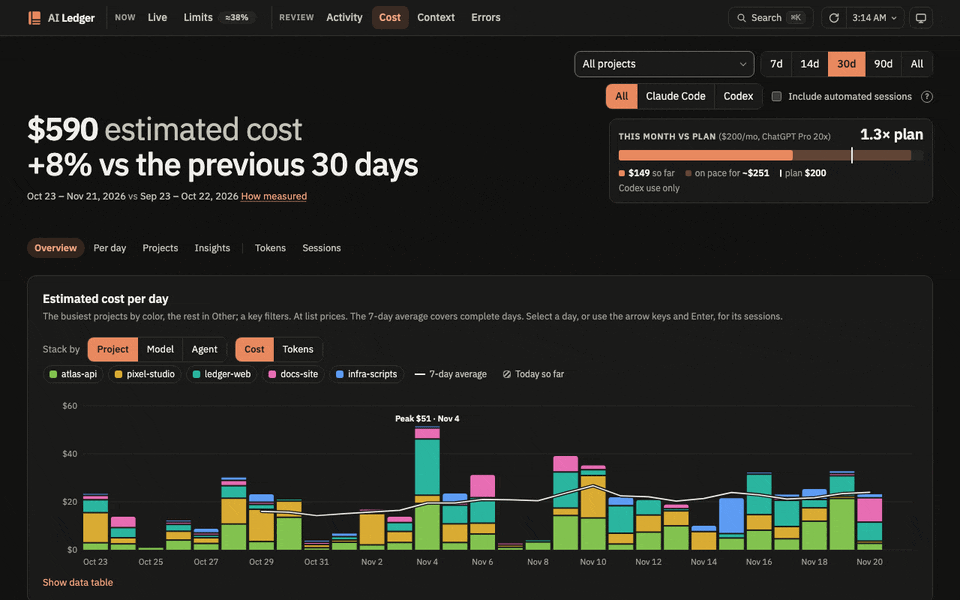
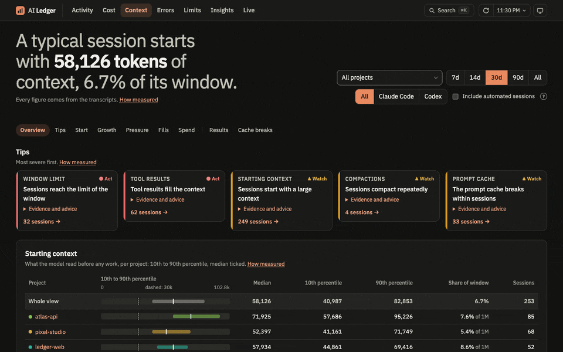
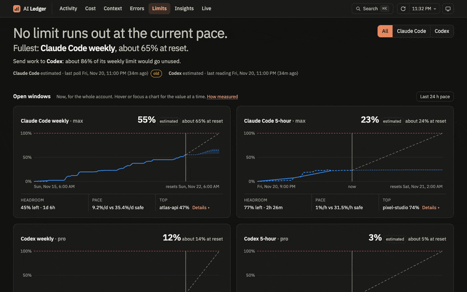
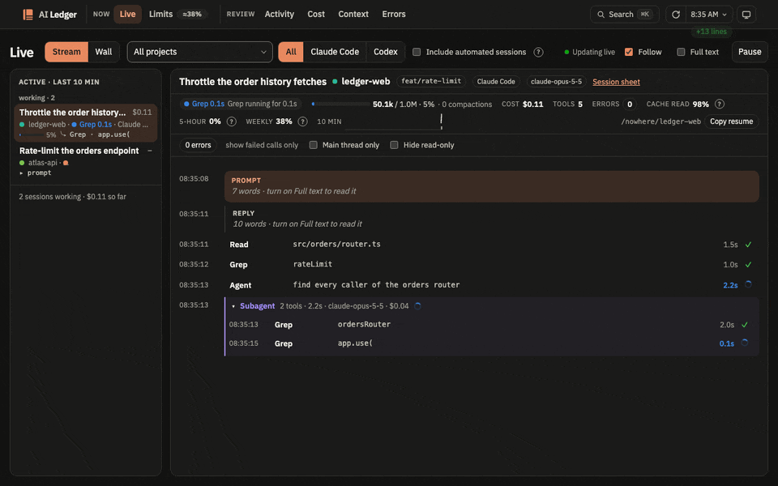

# AI Ledger

**See what Claude Code, Codex and Grok did, what it cost, and where they got stuck.**

AI Ledger reads your Claude Code, Codex and Grok CLI transcripts and turns them into six local dashboards. Your agents delete old transcripts; AI Ledger keeps every line.

It reads Claude Code's `~/.claude/projects`, Codex's `~/.codex` and Grok's `~/.grok/sessions/<folder>/<session>/updates.jsonl` (no other Grok file). A missing folder is skipped.

[Documentation](https://nwidart.github.io/ai-ledger/)

<picture><source media="(prefers-color-scheme: light)" srcset="https://raw.githubusercontent.com/nWidart/ai-ledger/main/docs/tour-light.gif"></picture>

## Quick start

```bash
uvx ai-ledger    # opens http://127.0.0.1:8765/ in your browser
```

Needs [uv](https://docs.astral.sh/uv/). Runs on macOS and Linux. Your data stays on your machine (see [Privacy](#privacy)).

## What you get

| Page | Shows |
| --- | --- |
| **Live** | Every active session as it runs, sorted by who needs you first. A strip above the stream shows the session's state, context, cost, errors, plan limits and a 10-minute pulse of context growth and tool calls, with Copy resume. When you scroll back, **Jump to latest** shows how many events arrived since. On the Wall, a tile pins up to two streams beside the tiles. Its tab counts the sessions that wait for you. |
| **Limits** | Each plan limit window with its forecast cone and the safe pace to its reset, what used it, and how past windows ended. Its tab shows how full the fullest window is. |
| **Activity** | What got done per day or week, by project, and what needs your attention. The work chart puts errors per 100 tool calls on a track under the bars; select a day or a week to narrow the tables, and from 14 bars a slider zooms the chart. Each tile opens the place that explains it, and the tables sit in tabs: Sessions, Projects, Tools and MCP, Loops and tests. It also shows the output speed per model second, with its trend, and how long sessions wait on the model and tools; that tile opens Sessions sorted by speed, and Sessions also sorts by model time. A **Columns** list hides any Sessions column but Session, or keeps one the window's width would hide; the browser remembers the choice. **Sort by several columns** (or Shift with a header press) sorts Sessions by up to three columns, and the hint says the whole order. A checkbox on each Sessions row selects up to four sessions, and **Compare** shows them side by side: one row per Sessions figure, each with the scope it has in the list, from the rows already loaded. Its **Judgments** view shows how Claude Code's `/insights` judged your sessions: the outcome mix as one bar and per week, how helpful Claude was, what each judged session cost, and which friction the costliest sessions had. |
| **Cost** | Estimated spend at API list prices per day (Grok's reported cost for Grok), and the month's pace against your plan. One table shows each project's trend, spend, change, cost per commit and cache hit. The tokens chart can show each day's share by token kind, and the Tokens and cache drawer sets each kind's share of tokens beside its share of cost. In views of 14 days or more, a slider under the daily chart zooms in on a stretch of days without changing the range or the totals. |
| **Context** | How full the context window gets, how fast it grows, what fills it, and what the prompt cache wastes. |
| **Errors** | Failed tool calls by type, the time they cost, a fix to paste into `CLAUDE.md` or `AGENTS.md`, and whether each fix worked. |
| **Project** | One project across all of the above in two columns, each block loading on its own, opened from the **Brief** link in the scope bar, its sheet, or its name in the command palette. |

Each page leads with its answer and its main chart. Full tables wait in drawers at the foot of the page, closed on every load, one open at a time; on Activity they sit in tabs under the chart. Method notes wait behind a **How measured** link.

Press **Cmd+K** to jump anywhere, for example `>errors #myproject #7d`. Right-click a project, session, tool or error type for its actions, such as copying a session's resume command. Every page works by keyboard and screen reader. Charts open a data table or read point by point with the arrow keys.

The navigation has two groups: **Now** (Live, Limits) and **Review** (Activity, Cost, Context, Errors). The Live tab shows a badge with the sessions waiting for an approval or for your next prompt. The Limits tab shows the percent of your fullest open limit window, in amber or red when a window is nearly full, at its limit or forecast to run out. The bar stays on one row at every width, and next to Refresh it shows when the data was last ingested.

The filters sit in one scope bar under the navigation, the same place on every page: project, range, source and **Include automated sessions**. Both bars stay at the top as you scroll, and nothing else does. With a project picked, the bar ends with a **Brief** link to that project's page. On a phone the bar is one **Filters** button that shows how many filters are set and opens them over the page.

Each page shows only the filters that change it. Limits shows the source only, and Live has no range. Activity's Judgments view has no source filter, because `/insights` judges Claude Code sessions only; with Codex or Grok as the source, Activity shows Overview and says why Judgments is not available. An old `/insights` link opens the Judgments view with its filters.

A session link on any page opens the session's sheet over that page, so the page keeps its state and Back closes the sheet; changing the project or source filter closes it too. **Open session** in Cmd+K and in the right-click menu does the same on every page, Limits included; on Live the stream keeps following its session. A session's sheet shows its model time, tool time, output speed and lines added and removed. These come from the `cost-state` line Claude Code writes when a session ends (from about late October 2026), so Codex and older Claude Code sessions show none. A Grok session shows model time and output speed, from the API time of each turn, and no tool time or lines.

Grok differs from the other two agents in a few ways:

- Grok writes token usage and cost once per turn, when the turn ends. The app splits a turn over its model calls by each call's context size: totals per turn, session, day, project and model are exact, one call's share is an estimate. A running turn shows no tokens or cost until it ends, and a turn that never ends (a crash, or a headless run killed by a signal) reports no usage.
- A Grok request costs what Grok reported, not an estimate at list prices.
- Grok records no reasoning effort, git branch, or session title, and `/insights` writes no judgments for it. A Grok cache break is never marked expired. Limits shows a Grok card when the Grok CLI is signed in with grok.com: the app asks xAI for the plan's credits every 5 minutes with that login's token, read from `~/.grok/auth.json` (or `$GROK_HOME/auth.json`). With an API key or no login, it sends nothing and Limits shows no Grok card. Grok names no plan, so Cost has no Grok plan from snapshots.

The [documentation site](https://nwidart.github.io/ai-ledger/) describes each page in detail. The top bar's **Docs** link and the command palette's `>docs` commands open the page you are on, and "Learn more" links in the explanations go to the section behind a figure; the app sends nothing to the site until you follow a link.

<table>
<tr><td><picture><source media="(prefers-color-scheme: light)" srcset="https://raw.githubusercontent.com/nWidart/ai-ledger/main/docs/activity-light.gif"></picture></td><td><picture><source media="(prefers-color-scheme: light)" srcset="https://raw.githubusercontent.com/nWidart/ai-ledger/main/docs/cost-light.gif"></picture></td></tr>
<tr><td><picture><source media="(prefers-color-scheme: light)" srcset="https://raw.githubusercontent.com/nWidart/ai-ledger/main/docs/context-light.gif"></picture></td><td><picture><source media="(prefers-color-scheme: light)" srcset="https://raw.githubusercontent.com/nWidart/ai-ledger/main/docs/project-light.gif"></picture></td></tr>
<tr><td><picture><source media="(prefers-color-scheme: light)" srcset="https://raw.githubusercontent.com/nWidart/ai-ledger/main/docs/errors-light.gif"></picture></td><td><picture><source media="(prefers-color-scheme: light)" srcset="https://raw.githubusercontent.com/nWidart/ai-ledger/main/docs/limits-light.gif"></picture></td></tr>
<tr><td><picture><source media="(prefers-color-scheme: light)" srcset="https://raw.githubusercontent.com/nWidart/ai-ledger/main/docs/insights-light.gif"></picture></td><td><picture><source media="(prefers-color-scheme: light)" srcset="https://raw.githubusercontent.com/nWidart/ai-ledger/main/docs/live-light.gif"></picture></td></tr>
</table>

## Install

```bash
uv tool install ai-ledger
ai-ledger                   # serve on http://127.0.0.1:8765/ and open it
uv tool upgrade ai-ledger   # new version and new prices
```

The first start reads every transcript, about 5 minutes for a month of heavy use. After that, the app picks up new lines every 60 seconds.

| Option | Default |
| --- | --- |
| `--port` | `8765` |
| `--no-open` | off (opens the browser) |
| `--projects` | `~/.claude/projects` |
| `--codex` | `~/.codex` |
| `--grok` | `~/.grok` |
| `--usage-data` | `~/.claude/usage-data` |
| `--db` | `~/Library/Application Support/ai-ledger/ai-ledger.duckdb` (macOS), `~/.local/share/ai-ledger/ai-ledger.duckdb` (Linux) |
| `--metrics-host HOST[:PORT]` | none; repeatable (see [Prometheus and Grafana](#prometheus-and-grafana)) |

With the app stopped, `ai-ledger ingest` reads new lines once and `ai-ledger rebuild` recomputes the derived tables. After an upgrade that asks for it, run `ai-ledger rebuild` once.

To set your own model prices or plan prices, or to hide more automated projects, see [Configuration](https://nwidart.github.io/ai-ledger/reference/configuration/). If the automated projects file (`automated.json`) cannot be used, one warning under the navigation says so on every page.

## Prometheus and Grafana

The app serves its figures in the Prometheus text format at `GET /metrics`, on the same listener as the pages. Prometheus on the same machine scrapes it like any other target:

```yaml
scrape_configs:
  - job_name: ai-ledger
    scrape_interval: 30s
    static_configs:
      - targets: ["127.0.0.1:8765"]
        labels: {instance: server}
```

Counters are totals over the whole store, so they survive a restart. The first scrape shows the whole history as one step; `rate()` and `increase()` are right from the second scrape on. The counters are worked out again only after an ingest stored something; the active-sessions gauge reads each active session's newest lines at every scrape, as the Live page does.

**A second machine.** Run one AI Ledger per machine and let one Prometheus scrape them all. The app keeps listening on `127.0.0.1`; publish only its `/metrics` path to your tailnet with `tailscale serve`:

```bash
tailscale serve --bg --https=8766 --set-path=/metrics http://127.0.0.1:8765/metrics
ai-ledger --metrics-host <machine>.<tailnet>.ts.net:8766
```

The proxy passes `Host: <machine>.<tailnet>.ts.net:8766`, which `--metrics-host` lets `GET /metrics` accept. Pages and `/api` still refuse it. In Prometheus, scrape the tailnet name over HTTPS and set an `instance` label per machine:

```yaml
  - job_name: ai-ledger-laptop
    scheme: https
    static_configs:
      - targets: ["<machine>.<tailnet>.ts.net:8766"]
        labels: {instance: laptop}
```

A laptop that sleeps shows as a down target and loses nothing: the next scrape reads the store totals.

**Workloads.** To tell groups of sessions apart, such as pull-request review agents next to sessions you start by hand, add `workloads.json` beside the store. The first entry whose `prompt_prefix` starts a session's first prompt names its workload; the others are `default`.

```json
{"workloads": [{"name": "pr-review", "prompt_prefix": "You work on pull request #"}]}
```

| Family | Type | Labels besides `source`, `project`, `automated`, `workload` |
| --- | --- | --- |
| `ai_ledger_requests_total`, `ai_ledger_unpriced_requests_total`, `ai_ledger_cost_usd_total` | counter | `model` |
| `ai_ledger_tokens_total` | counter | `model`, `kind` (`input`, `output`, `thinking`, `cache_read`, `cache_5m`, `cache_1h`) |
| `ai_ledger_sessions_total`, `ai_ledger_prompts_total`, `ai_ledger_compactions_total`, `ai_ledger_commits_total`, `ai_ledger_model_seconds_total` | counter | |
| `ai_ledger_test_runs_total` | counter | `result` (`passed`, `failed`) |
| `ai_ledger_tool_calls_total` | counter | `tool`, `result` (`ok`, `error`) |
| `ai_ledger_tool_errors_total` | counter | `category` |
| `ai_ledger_tool_call_duration_seconds` | histogram | `tool`; only `source`, `workload` and `tool` |
| `ai_ledger_active_sessions` | gauge | `state`; no `automated` |
| `ai_ledger_limit_used_ratio`, `ai_ledger_limit_resets_timestamp_seconds` | gauge | `provider`, `limit`, `window` only |
| `ai_ledger_last_ingest_timestamp_seconds`, `ai_ledger_ingest_failed` | gauge | none |
| `ai_ledger_build_info` | gauge | `version` |

Cost is the reported cost, else the list-price estimate, as on Cost; a request with neither counts in `ai_ledger_unpriced_requests_total`.

**What leaves the store.** Project, model, tool, error-category and workload names, and the app version. Never a prompt, command, path, error text or session id.

**Grafana.** Import [`contrib/grafana/ai-ledger.json`](contrib/grafana/ai-ledger.json) (Dashboards, New, Import) and pick your Prometheus data source. It filters by instance, source, project, workload and automated flag, and shows spend, tokens, cache hit, requests by model, tool errors and latency, active sessions, plan limits and ingest freshness.

The [documentation site](https://nwidart.github.io/ai-ledger/reference/metrics/) lists every metric and panel.

## Privacy

- The server listens on `127.0.0.1` only, and refuses requests that another site makes from your browser. `GET /metrics` serves project, model and tool names to any Prometheus that can reach it; see [Prometheus and Grafana](#prometheus-and-grafana).
- The store keeps every transcript line, **including any secrets** that appeared in a session. Only your user can read it. Do not share it.
- On macOS, the Limits page sends your Claude Code OAuth token from the Keychain to Anthropic's usage endpoint every 5 minutes. The token goes nowhere else and is never stored or logged. On Linux there is no Keychain to read, so Limits shows no Claude Code window.
- If the Grok CLI is signed in with grok.com, the Limits page sends that login's access token, read from `~/.grok/auth.json` (or `$GROK_HOME/auth.json`), to `https://cli-chat-proxy.grok.com/v1/billing?format=credits` every 5 minutes. The token goes nowhere else, is never stored, logged or shown, and is never refreshed. With an API key or no login, nothing is sent.
- Live's **Full text** puts transcript content on screen, secrets included. Turn it off before you share your screen. Even off, Live shows the start of each tool input and the error text of failed calls, and other pages quote error examples. See [Share your screen safely](https://nwidart.github.io/ai-ledger/improve/share-screen/).
- Your browser loads the font from Google Fonts. No transcript data goes with it.

## Contributing

See [CONTRIBUTING.md](https://github.com/nWidart/ai-ledger/blob/main/CONTRIBUTING.md).

## License

[MIT](https://github.com/nWidart/ai-ledger/blob/main/LICENSE)
