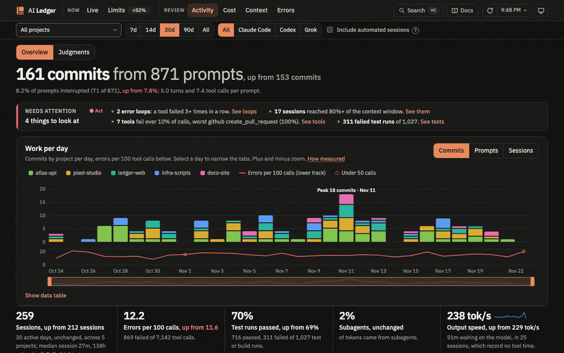
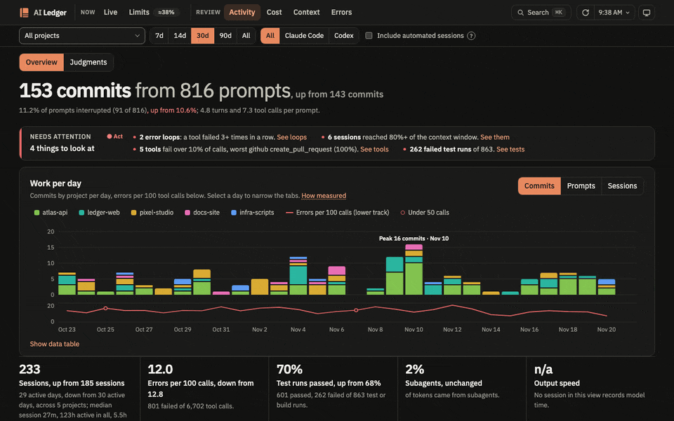
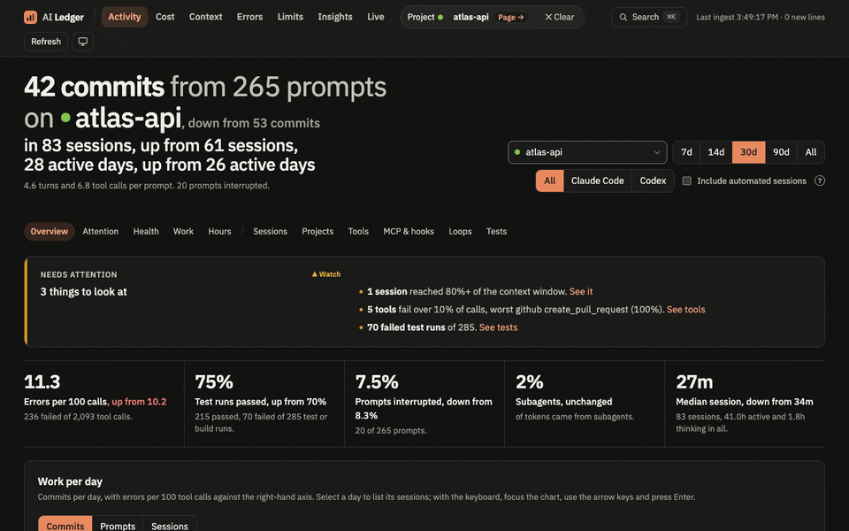
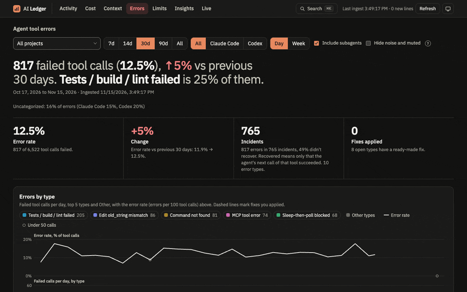

# AI Ledger

**See what Claude Code and Codex did, what it cost, and where they got stuck.**

AI Ledger reads your Claude Code and Codex transcripts and turns them into seven local dashboards. Your agents delete old transcripts; AI Ledger keeps every line.

[Documentation](https://nwidart.github.io/ai-ledger/)

<picture><source media="(prefers-color-scheme: light)" srcset="https://raw.githubusercontent.com/nWidart/ai-ledger/main/docs/tour-light.gif"></picture>

## Quick start

```bash
uvx ai-ledger    # opens http://127.0.0.1:8765/ in your browser
```

Needs [uv](https://docs.astral.sh/uv/). Runs on macOS and Linux. Your data stays on your machine (see [Privacy](#privacy)).

## What you get

| Page | Shows |
| --- | --- |
| **Activity** | What got done per day or week, by project, and what needs your attention. It also shows the output speed per model second and how long a median session waits on the model and tools. |
| **Cost** | Estimated spend at API list prices per day, and the month's pace against your plan. One table shows each project's trend, spend, change, cost per commit and cache hit. The tokens chart can show each day's share by token kind, and the Tokens and cache drawer sets each kind's share of tokens beside its share of cost. |
| **Context** | How full the context window gets, how fast it grows, what fills it, and what the prompt cache wastes. |
| **Errors** | Failed tool calls by type, the time they cost, and a fix to paste into `CLAUDE.md` or `AGENTS.md`. |
| **Limits** | Each plan limit window with its forecast cone and the safe pace to its reset, what used it, and how past windows ended. |
| **Insights** | How Claude Code's `/insights` judged your sessions. |
| **Live** | Every active session as it runs, sorted by who needs you first. |
| **Project** | One project across all of the above in two columns, each block loading on its own, opened from the "Project page" link beside the project filter, its sheet, or its name in the command palette. |

Each page leads with its answer and its main chart. Full tables wait in drawers at the foot of the page, closed on every load, one open at a time; method notes wait behind a **How measured** link.

Press **Cmd+K** to jump anywhere, for example `>errors #myproject #7d`. Right-click a project, session, tool or error type for its actions, such as copying a session's resume command. Every page works by keyboard and screen reader. Charts open a data table or read point by point with the arrow keys. The navigation stays on one row at every width, and next to Refresh it shows when the data was last ingested.

A session link on any page opens the session's sheet over that page, so the page keeps its state and Back closes the sheet. **Open session** in Cmd+K and in the right-click menu does the same on every page that shows sessions; on Live the stream keeps following its session. A session's sheet shows its model time, tool time, output speed and lines added and removed. These come from the `cost-state` line Claude Code writes when a session ends (from about late October 2026), so Codex and older Claude Code sessions show none.

The [documentation site](https://nwidart.github.io/ai-ledger/) describes each page in detail.

<table>
<tr><td><picture><source media="(prefers-color-scheme: light)" srcset="https://raw.githubusercontent.com/nWidart/ai-ledger/main/docs/activity-light.gif"></picture></td><td><picture><source media="(prefers-color-scheme: light)" srcset="https://raw.githubusercontent.com/nWidart/ai-ledger/main/docs/cost-light.gif"></picture></td></tr>
<tr><td><picture><source media="(prefers-color-scheme: light)" srcset="https://raw.githubusercontent.com/nWidart/ai-ledger/main/docs/context-light.gif"></picture></td><td><picture><source media="(prefers-color-scheme: light)" srcset="https://raw.githubusercontent.com/nWidart/ai-ledger/main/docs/project-light.gif"></picture></td></tr>
<tr><td><picture><source media="(prefers-color-scheme: light)" srcset="https://raw.githubusercontent.com/nWidart/ai-ledger/main/docs/errors-light.gif"></picture></td><td><picture><source media="(prefers-color-scheme: light)" srcset="https://raw.githubusercontent.com/nWidart/ai-ledger/main/docs/limits-light.gif"></picture></td></tr>
<tr><td><picture><source media="(prefers-color-scheme: light)" srcset="https://raw.githubusercontent.com/nWidart/ai-ledger/main/docs/insights-light.gif"></picture></td><td><picture><source media="(prefers-color-scheme: light)" srcset="https://raw.githubusercontent.com/nWidart/ai-ledger/main/docs/live-light.gif"></picture></td></tr>
</table>

## Install

```bash
uv tool install ai-ledger
ai-ledger                   # serve on http://127.0.0.1:8765/ and open it
uv tool upgrade ai-ledger   # new version and new prices
```

The first start reads every transcript, about 5 minutes for a month of heavy use. After that, the app picks up new lines every 60 seconds.

| Option | Default |
| --- | --- |
| `--port` | `8765` |
| `--no-open` | off (opens the browser) |
| `--projects` | `~/.claude/projects` |
| `--codex` | `~/.codex` |
| `--usage-data` | `~/.claude/usage-data` |
| `--db` | `~/Library/Application Support/ai-ledger/ai-ledger.duckdb` (macOS), `~/.local/share/ai-ledger/ai-ledger.duckdb` (Linux) |

With the app stopped, `ai-ledger ingest` reads new lines once and `ai-ledger rebuild` recomputes the derived tables. After an upgrade that asks for it, run `ai-ledger rebuild` once.

To set your own model prices or plan prices, or to hide more automated projects, see [Configuration](https://nwidart.github.io/ai-ledger/reference/configuration/). If the automated projects file (`automated.json`) cannot be used, one warning under the navigation says so on every page.

## Privacy

- The server listens on `127.0.0.1` only, and refuses requests that another site makes from your browser.
- The store keeps every transcript line, **including any secrets** that appeared in a session. Only your user can read it. Do not share it.
- On macOS, the Limits page sends your Claude Code OAuth token from the Keychain to Anthropic's usage endpoint every 5 minutes. The token goes nowhere else and is never stored or logged. On Linux there is no Keychain to read, so Limits shows Codex windows only.
- Live's **Full text** puts transcript content on screen, secrets included. Turn it off before you share your screen. Even off, Live shows the start of each tool input and the error text of failed calls, and other pages quote error examples. See [Share your screen safely](https://nwidart.github.io/ai-ledger/improve/share-screen/).
- Your browser loads the font from Google Fonts. No transcript data goes with it.

## Contributing

See [CONTRIBUTING.md](https://github.com/nWidart/ai-ledger/blob/main/CONTRIBUTING.md).

## License

[MIT](https://github.com/nWidart/ai-ledger/blob/main/LICENSE)
